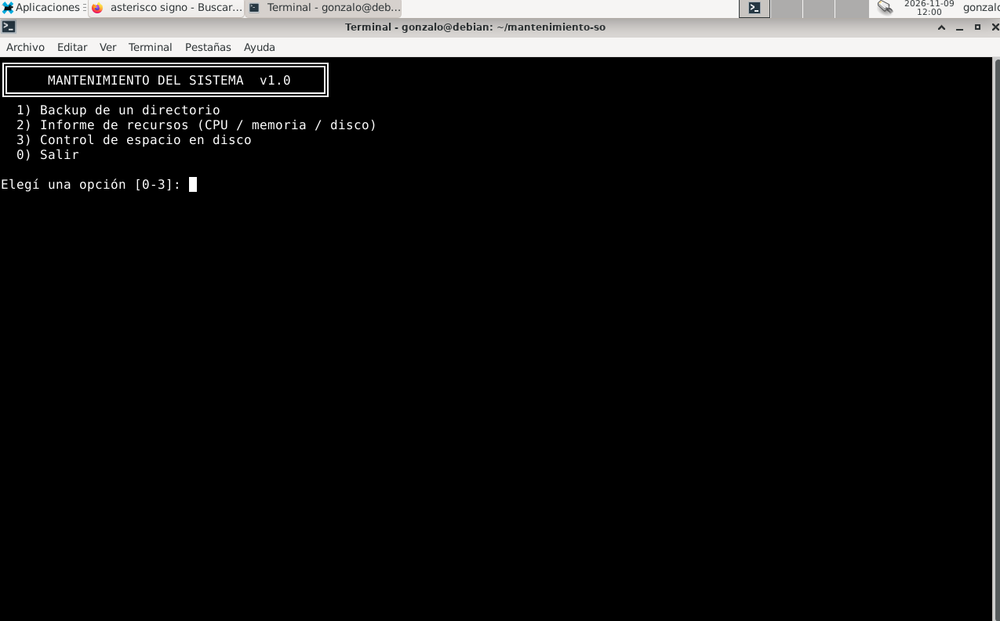
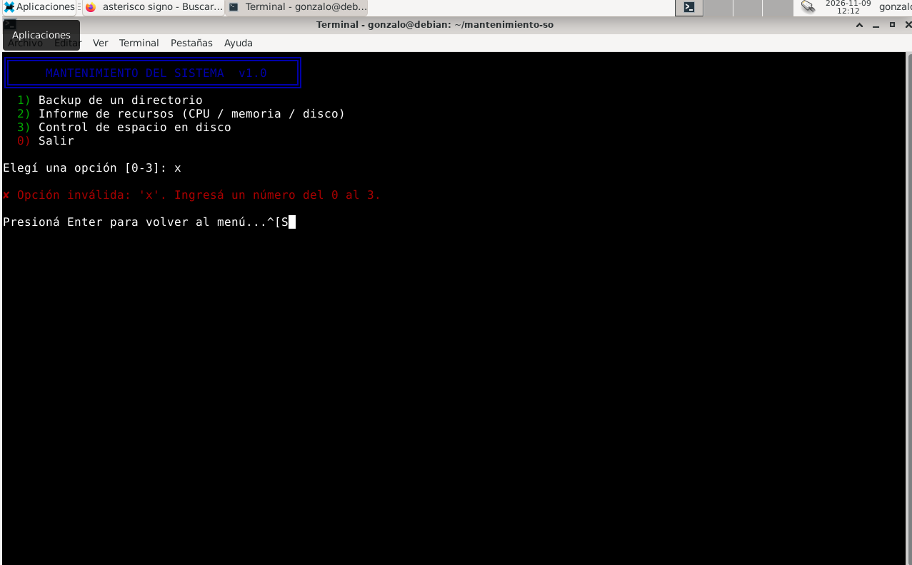
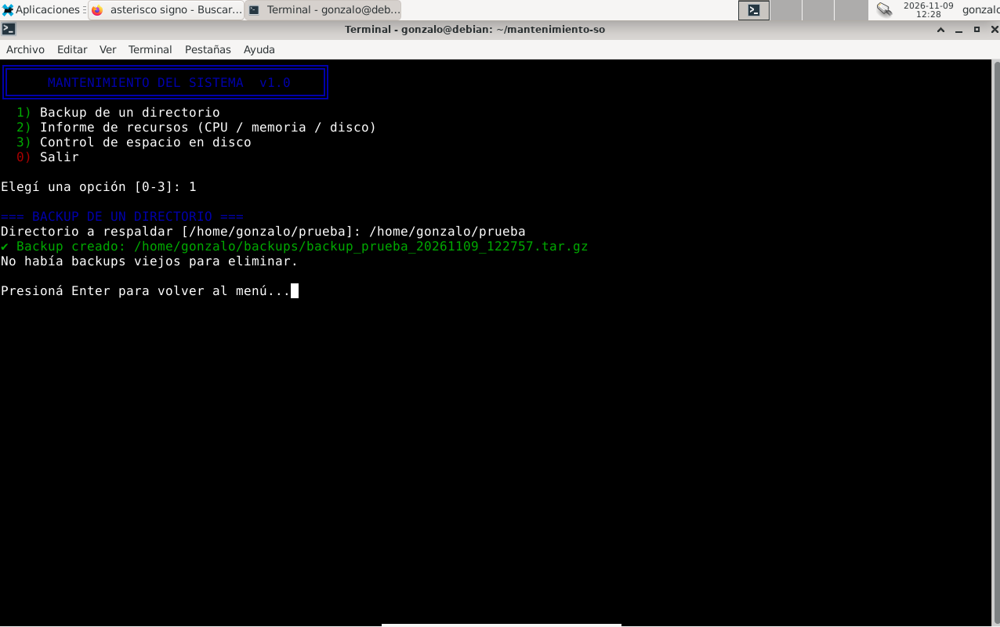
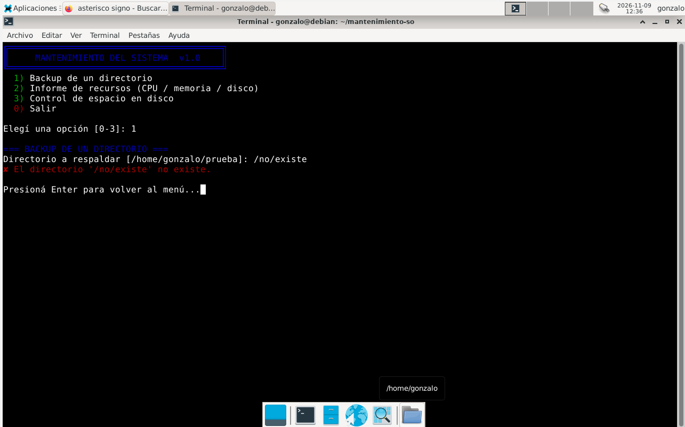
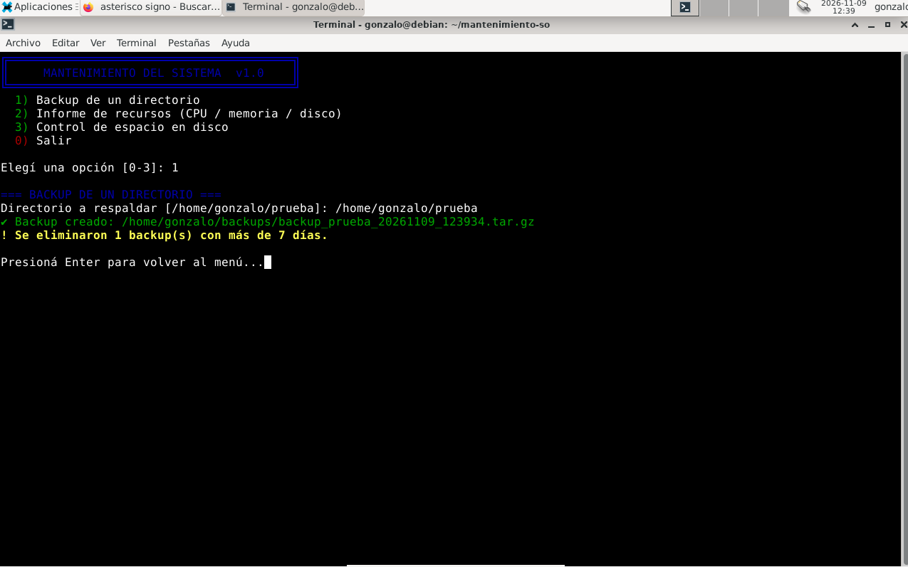
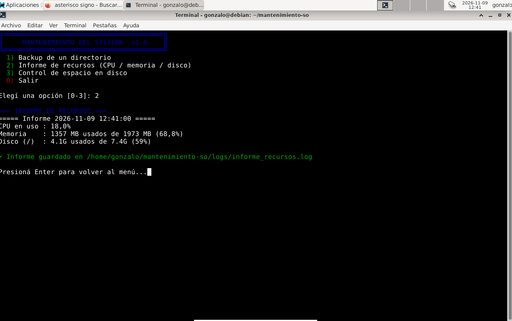
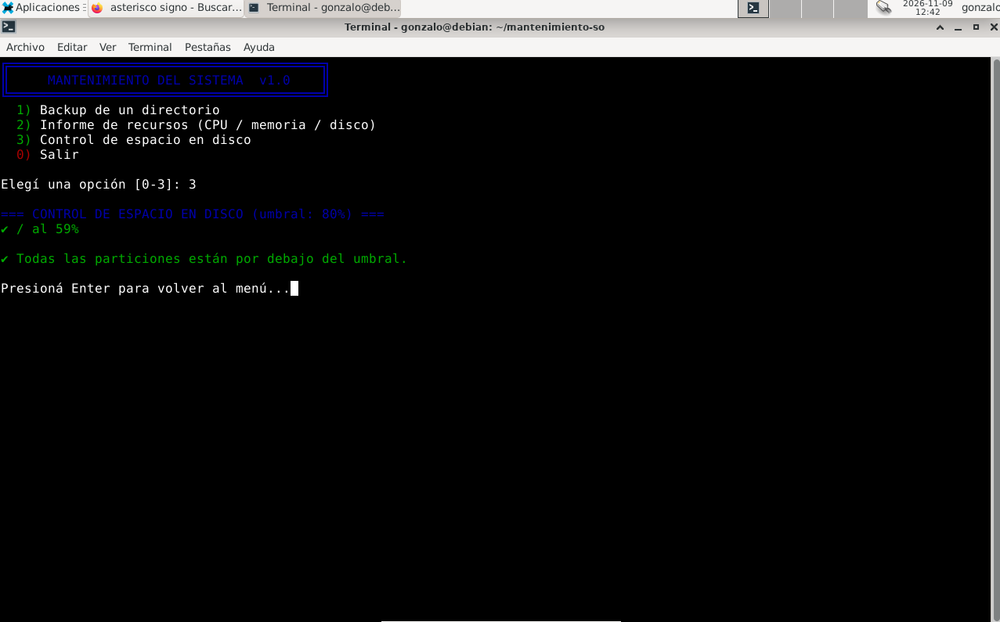
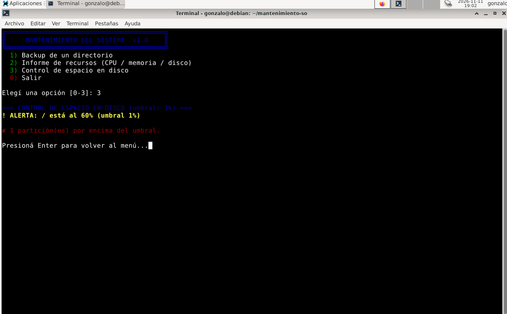
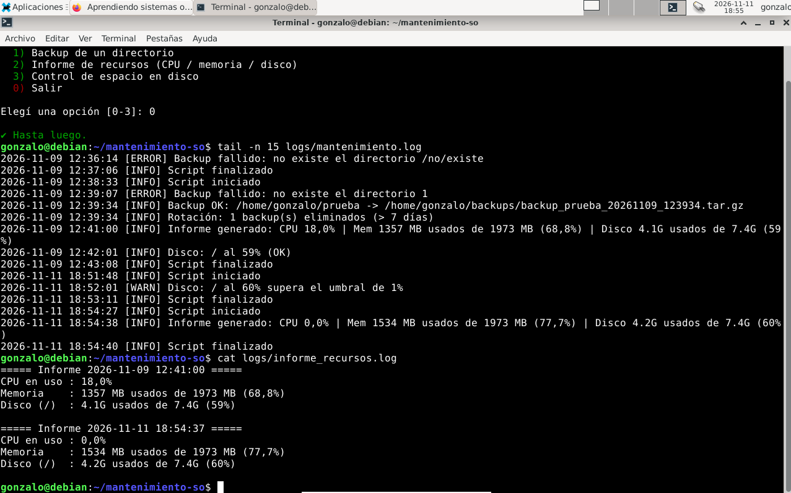

# Memoria técnica — Mantenimiento del Sistema en Bash

**Materia:** Sistemas Operativos
**Institución:** Instituto Superior IDRA — Tecnicatura Superior en Desarrollo de Software
**Integrantes:** D'arino Agustin, Zampino Facundo y Mungiello Gonzalo
**Repositorio:** (https://github.com/gonzamungiello/mantenimiento-so.git)

---

## Índice

1. [Introducción](#1-introducción)
2. [Requisitos técnicos](#2-requisitos-técnicos)
3. [Desarrollo](#3-desarrollo)
4. [Pruebas y validación](#4-pruebas-y-validación)
5. [Reflexiones finales](#5-reflexiones-finales)

---

## 1. Introducción

### 1.1 Descripción del proyecto

Este proyecto es un script en Bash con **menú interactivo** que automatiza tareas habituales de mantenimiento en un sistema Linux. Fue desarrollado como Trabajo Final de la materia Sistemas Operativos, con el objetivo de aplicar e integrar los conceptos vistos durante la cursada: procesos, sistema de archivos, redirecciones y pipes, códigos de salida, variables de entorno, permisos y registro de eventos (logging).

El script se desarrolló y se probó en una máquina virtual con **Debian** ejecutándose en VirtualBox, y se entrega junto con esta memoria en un repositorio público de GitHub.

### 1.2 Tareas automatizadas

De las opciones propuestas en la consigna se implementaron tres:

| N.º | Tarea | Descripción | Herramientas principales |
|---|---|---|---|
| 1 | **Backup de un directorio** | Comprime un directorio en un archivo `.tar.gz` con fecha y hora en el nombre y elimina los backups con más antigüedad que un límite configurable. | `tar`, `find`, `date` |
| 2 | **Informe de recursos** | Muestra y guarda en un archivo log el uso actual de CPU, memoria y disco. | `top`, `free`, `df`, `awk`, `tee` |
| 3 | **Control de espacio en disco** | Verifica el porcentaje de ocupación de cada partición y genera una alerta en el log cuando se supera un umbral configurable. | `df`, `awk` |

### 1.3 Extras implementados

- **Validación de entrada** en el menú: cualquier opción no válida (letras, vacío, números fuera de rango) muestra un mensaje de error y vuelve a mostrar el menú.
- **Archivo de configuración** (`config.conf`): permite cambiar rutas, días de retención y umbral de disco sin editar el código.

### 1.4 Decisión de diseño

El proyecto se organizó **separando responsabilidades**: los parámetros viven en un archivo de configuración, las herramientas comunes (colores y registro de eventos) en una librería, cada tarea en su propio módulo y el script principal solo se encarga de mostrar el menú y derivar a cada módulo. Esto facilita el mantenimiento, la lectura y el trabajo en equipo: si falla el backup, se sabe en qué archivo mirar.

---

## 2. Requisitos técnicos

### 2.1 Entorno

| Elemento | Detalle |
|---|---|
| Sistema operativo | Debian GNU/Linux (máquina virtual en VirtualBox) |
| Intérprete | Bash (versión 4 o superior) |
| Control de versiones | Git y GitHub |

### 2.2 Herramientas y dependencias

Todas las herramientas que usa el script vienen instaladas por defecto en Debian, salvo `git`, que se necesita únicamente para clonar el repositorio:

| Herramienta | Paquete | Uso en el proyecto |
|---|---|---|
| `tar`, `gzip` | `tar`, `gzip` | Crear los backups comprimidos |
| `find`, `wc`, `date`, `df`, `tee` | `findutils`, `coreutils` | Rotación de backups, fechas, disco, registro |
| `top`, `free` | `procps` | Medición de CPU y memoria |
| `awk` | `mawk` | Extraer columnas de la salida de los comandos |
| `git` | `git` | Clonar y versionar el proyecto |

### 2.3 Instalación y ejecución

En Debian, `sudo` puede no estar instalado, por lo que la instalación de paquetes se hace como root con `su -`:

```bash
su -
apt update
apt install git
exit
```

Luego se clona el repositorio y se ejecuta el script:

```bash
git clone https://github.com/USUARIO/mantenimiento-so.git
cd mantenimiento-so
chmod +x mantenimiento.sh
./mantenimiento.sh
```

El comando `chmod +x` otorga el permiso de ejecución al archivo; sin él, el sistema no permite lanzarlo con `./`.

---

## 3. Desarrollo

### 3.1 Estructura del proyecto

```text
mantenimiento-so/
├── mantenimiento.sh        # Script principal con el menú interactivo
├── config.conf             # Parámetros configurables
├── lib/
│   └── utils.sh            # Colores, función de log y mensajes
├── modulos/
│   ├── backup.sh           # Tarea 1: backup y rotación
│   ├── recursos.sh         # Tarea 2: informe de recursos
│   └── disco.sh            # Tarea 3: control de disco
├── logs/                   # Archivos de registro (se crean solos)
├── docs/
│   └── memoria_tecnica.md  # Esta memoria
├── README.md
└── LICENSE
```

### 3.2 Flujo de ejecución

1. Se ejecuta `./mantenimiento.sh`, que calcula `DIR`, la carpeta donde vive el script.
2. Con `source` se cargan `config.conf`, `lib/utils.sh` y los tres módulos. En este paso solo se **definen** las funciones; todavía no se ejecutan.
3. Se registra "Script iniciado" en el log y se entra a un bucle `while true`.
4. En cada vuelta se muestra el menú, se lee la opción con `read` y se deriva con `case`.
5. La opción `0` registra "Script finalizado" y termina con `exit 0`. Cualquier otra entrada muestra un error y vuelve al menú.

### 3.3 Archivo de configuración: `config.conf`

```bash
# ============================================================
# config.conf - Parámetros del script (se pueden cambiar sin
# tocar el código). Es un archivo de variables Bash: sin espacios
# alrededor del "=".
# ============================================================

# --- Backup ---
BACKUP_ORIGEN="$HOME/prueba"        # directorio que se respalda por defecto
BACKUP_DESTINO="$HOME/backups"      # dónde se guardan los .tar.gz
DIAS_RETENCION=7                    # backups más viejos que esto se borran

# --- Control de disco ---
UMBRAL_DISCO=80                    # % de ocupación a partir del cual se alerta
```

Es un archivo de variables Bash (`NOMBRE=valor`, sin espacios alrededor del `=`) que el script principal carga con `source`.

- `BACKUP_ORIGEN` y `BACKUP_DESTINO`: directorio a respaldar por defecto y carpeta donde se guardan los backups. Usan `$HOME`, una **variable de entorno** que apunta al directorio personal del usuario, así que las rutas funcionan en cualquier máquina.
- `DIAS_RETENCION`: los backups con más de esta cantidad de días se eliminan.
- `UMBRAL_DISCO`: porcentaje de ocupación a partir del cual se genera una alerta.

### 3.4 Utilidades compartidas: `lib/utils.sh`

```bash
#!/bin/bash
# lib/utils.sh - Funciones y variables compartidas por todos los módulos.
# Requiere que la variable DIR (carpeta del proyecto) esté definida antes.

# --- Colores (secuencias de escape ANSI) ---
VERDE='\033[0;32m'
ROJO='\033[0;31m'
AMARILLO='\033[1;33m'
AZUL='\033[0;34m'
NC='\033[0m'            # "No Color": vuelve al color normal

LOG_FILE="$DIR/logs/mantenimiento.log"
mkdir -p "$DIR/logs"

# log NIVEL "mensaje"  ->  2026-11-02 10:15:00 [INFO] mensaje
log() {
    echo "$(date '+%Y-%m-%d %H:%M:%S') [$1] $2" >> "$LOG_FILE"
}

# Mensajes con color para el usuario
ok()    { echo -e "${VERDE}✔ $1${NC}"; }
error() { echo -e "${ROJO}✘ $1${NC}"; }
aviso() { echo -e "${AMARILLO}! $1${NC}"; }

pausa() {
    echo
    read -rp "Presioná Enter para volver al menú..." _
}
```

- **Colores:** `\033[0;32m` es una secuencia de escape ANSI. `\033` es el carácter ESC y `[0;32m` le indica a la terminal "color verde". La variable `NC` (*No Color*) restablece el color normal; sin ese reinicio, todo el texto siguiente quedaría pintado.
- **`log NIVEL "mensaje"`:** `$1` es el nivel (`INFO`, `WARN`, `ERROR`) y `$2` el mensaje. `date '+%Y-%m-%d %H:%M:%S'` agrega fecha y hora. El operador `>>` **agrega** al final del archivo; con un solo `>` se sobrescribiría y se perdería el historial.
- **`ok`, `error`, `aviso`:** atajos para mostrar mensajes en verde, rojo y amarillo.
- **`pausa`:** espera que el usuario presione Enter, para que alcance a leer el resultado antes de que `clear` borre la pantalla.
- **`mkdir -p`:** crea la carpeta de logs si no existe; la opción `-p` evita el error si ya existe.

### 3.5 Script principal y menú: `mantenimiento.sh`

```bash
#!/bin/bash
# ============================================================
# mantenimiento.sh - Script principal con menú interactivo
# Tareas: 1) Backup  2) Informe de recursos  3) Control de disco
# ============================================================

# Carpeta donde vive el script (así funciona se ejecute desde donde se ejecute)
DIR="$(cd "$(dirname "${BASH_SOURCE[0]}")" && pwd)"

source "$DIR/config.conf"
source "$DIR/lib/utils.sh"
source "$DIR/modulos/backup.sh"
source "$DIR/modulos/recursos.sh"
source "$DIR/modulos/disco.sh"

mostrar_menu() {
    clear
    echo -e "${AZUL}╔════════════════════════════════════════╗${NC}"
    echo -e "${AZUL}║     MANTENIMIENTO DEL SISTEMA  v1.0    ║${NC}"
    echo -e "${AZUL}╚════════════════════════════════════════╝${NC}"
    echo -e "  ${VERDE}1)${NC} Backup de un directorio"
    echo -e "  ${VERDE}2)${NC} Informe de recursos (CPU / memoria / disco)"
    echo -e "  ${VERDE}3)${NC} Control de espacio en disco"
    echo -e "  ${ROJO}0)${NC} Salir"
    echo
}

log INFO "Script iniciado"

while true; do
    mostrar_menu
    read -rp "Elegí una opción [0-3]: " opcion
    echo
    case "$opcion" in
        1) hacer_backup;     pausa ;;
        2) generar_informe;  pausa ;;
        3) controlar_disco;  pausa ;;
        0) ok "Hasta luego."; log INFO "Script finalizado"; exit 0 ;;
        *) error "Opción inválida: '$opcion'. Ingresá un número del 0 al 3."; pausa ;;
    esac
done
```

- **`DIR="$(cd "$(dirname "${BASH_SOURCE[0]}")" && pwd)"`:** `${BASH_SOURCE[0]}` es la ruta del script en ejecución, `dirname` extrae su carpeta y `cd ... && pwd` devuelve la ruta absoluta. Está dentro de `$( )`, que corre en un subshell, así que el `cd` no modifica la carpeta actual. Gracias a esto el script encuentra sus archivos sin importar desde dónde se lo ejecute.
- **`source`:** ejecuta el archivo **en el mismo proceso**, por lo que sus variables y funciones quedan disponibles. Si se usara `./archivo.sh`, se crearía un proceso hijo y todo se perdería al terminar.
- **`while true`:** bucle infinito que solo se corta con `exit`.
- **`read -rp`:** guarda lo que escribe el usuario en la variable `opcion`. `-p` muestra el mensaje y `-r` evita que se interpreten las barras invertidas.
- **`case`:** compara `$opcion` con cada patrón; `;;` cierra cada rama. El patrón `*)` captura cualquier otra entrada y constituye la **validación de entrada**: cubre letras, entradas vacías y números fuera de rango.
- **`exit 0`:** termina el script con código de salida 0 (éxito). Es la opción para detener la ejecución que pide la consigna.

### 3.6 Tarea 1 — Backup: `modulos/backup.sh`

```bash
#!/bin/bash
# modulos/backup.sh - Tarea 1: backup comprimido + borrado de backups viejos.

hacer_backup() {
    echo -e "${AZUL}=== BACKUP DE UN DIRECTORIO ===${NC}"
    read -rp "Directorio a respaldar [$BACKUP_ORIGEN]: " origen
    origen="${origen:-$BACKUP_ORIGEN}"      # si no escribe nada, usa el de config

    # 1) Validar que el origen exista
    if [ ! -d "$origen" ]; then
        error "El directorio '$origen' no existe."
        log ERROR "Backup fallido: no existe el directorio $origen"
        return 1
    fi

    # 2) Preparar destino y nombre del archivo (con fecha y hora)
    mkdir -p "$BACKUP_DESTINO"
    local base archivo
    base="$(basename "$origen")"
    archivo="$BACKUP_DESTINO/backup_${base}_$(date +%Y%m%d_%H%M%S).tar.gz"

    # 3) Crear el .tar.gz. -C entra al directorio padre para que el
    #    archivo contenga "prueba/..." y no la ruta absoluta completa.
    if tar -czf "$archivo" -C "$(dirname "$origen")" "$base"; then
        ok "Backup creado: $archivo"
        log INFO "Backup OK: $origen -> $archivo"
    else
        error "Falló la creación del backup."
        log ERROR "Backup fallido: tar devolvió error con $origen"
        return 1
    fi

    # 4) Rotación: borrar backups viejos
    limpiar_backups_viejos
}

limpiar_backups_viejos() {
    local borrados
    # -maxdepth 1: solo esta carpeta. -name: SOLO nuestros backups.
    # -mtime +N: modificados hace más de N días.
    borrados=$(find "$BACKUP_DESTINO" -maxdepth 1 -type f -name "backup_*.tar.gz" \
               -mtime +"$DIAS_RETENCION" -print -delete | wc -l)
    if [ "$borrados" -gt 0 ]; then
        aviso "Se eliminaron $borrados backup(s) con más de $DIAS_RETENCION días."
        log INFO "Rotación: $borrados backup(s) eliminados (> $DIAS_RETENCION días)"
    else
        echo "No había backups viejos para eliminar."
        log INFO "Rotación: nada para eliminar"
    fi
}
```

- **`${origen:-$BACKUP_ORIGEN}`:** expansión con valor por defecto. Si el usuario no escribe nada, se usa la ruta de `config.conf`.
- **`[ ! -d "$origen" ]`:** `-d` es verdadero si la ruta existe y es un directorio; `!` lo niega. Si no existe, se informa, se registra un `ERROR` y se sale con `return 1`. Se usa `return` y no `exit` para que el menú siga funcionando.
- **`local`:** limita las variables a la función.
- **`basename` / `dirname`:** separan el nombre de la carpeta (`prueba`) de su ruta (`/home/usuario`).
- **`date +%Y%m%d_%H%M%S`:** incluye fecha y hora en el nombre, de modo que cada backup es único y se ordena cronológicamente.
- **`tar -czf archivo -C padre base`:** `c` crea, `z` comprime con gzip y `f` indica el nombre del archivo. `-C` entra a la carpeta padre antes de empaquetar, así el `.tar.gz` guarda `prueba/a.txt` y no la ruta absoluta completa.
- **`if tar ...; then`:** el `if` evalúa el **código de salida** del comando: 0 es éxito y cualquier otro valor es error. Según el resultado se registra `INFO` o `ERROR`.
- **Rotación con `find`:**
  - `-maxdepth 1`: no entra a subcarpetas.
  - `-type f`: solo archivos.
  - `-name "backup_*.tar.gz"`: solo los backups generados por este script. Es una medida de seguridad para no borrar otros archivos.
  - `-mtime +N`: modificados hace más de N días.
  - `-print -delete`: muestra cada archivo y lo elimina.
  - `| wc -l`: cuenta las líneas impresas, es decir, cuántos backups se borraron. El pipe `|` conecta la salida de un comando con la entrada del siguiente.

### 3.7 Tarea 2 — Informe de recursos: `modulos/recursos.sh`

```bash
#!/bin/bash
# modulos/recursos.sh - Tarea 2: informe de CPU, memoria y disco en un log.
# LC_ALL=C fuerza idioma/formato estándar: sin esto, en un sistema en
# español "free" muestra "Memoria:" en vez de "Mem:" y el awk no encuentra nada.

generar_informe() {
    echo -e "${AZUL}=== INFORME DE RECURSOS ===${NC}"
    local cpu mem disco informe_log fecha
    informe_log="$DIR/logs/informe_recursos.log"
    fecha="$(date '+%Y-%m-%d %H:%M:%S')"

    # CPU en uso = us (usuario) + sy (sistema), de la línea "%Cpu(s)" de top
    cpu=$(LC_ALL=C top -bn1 | grep "Cpu(s)" | awk '{printf "%.1f", $2 + $4}')

    # Memoria: columnas total ($2) y usada ($3) de la línea "Mem:"
    mem=$(LC_ALL=C free -m | awk '/^Mem:/ {printf "%d MB usados de %d MB (%.1f%%)", $3, $2, $3*100/$2}')

    # Disco raíz: usado ($3), total ($2) y porcentaje ($5) de la 2da línea
    disco=$(LC_ALL=C df -h / | awk 'NR==2 {print $3 " usados de " $2 " (" $5 ")"}')

    {
        echo "===== Informe $fecha ====="
        echo "CPU en uso : ${cpu}%"
        echo "Memoria    : $mem"
        echo "Disco (/)  : $disco"
        echo
    } | tee -a "$informe_log"

    ok "Informe guardado en $informe_log"
    log INFO "Informe generado: CPU ${cpu}% | Mem $mem | Disco $disco"
}
```

- **`LC_ALL=C`:** fuerza el idioma y formato estándar solo para ese comando. Sin esto, en un sistema en español `free` escribe "Memoria:" en lugar de "Mem:" y los decimales pueden salir con coma, lo que haría fallar el `awk`. Hace al script más robusto.
- **CPU:** `top -bn1` ejecuta `top` en modo batch (`b`, no interactivo) con una sola iteración (`n1`). `grep "Cpu(s)"` se queda con la línea de CPU y `awk '{printf "%.1f", $2 + $4}'` suma `$2` (*us*, CPU en modo usuario) y `$4` (*sy*, modo sistema).
- **Memoria:** `free -m` muestra la memoria en MB. El patrón `/^Mem:/` hace que `awk` actúe solo en la línea que empieza con "Mem:"; `$2` es el total y `$3` lo usado. El porcentaje se calcula a mano y `%%` imprime un `%` literal.
- **Disco:** `df -h /` muestra el espacio de la partición raíz en formato legible. `NR==2` selecciona la segunda línea, porque la primera es el encabezado.
- **`{ ...; } | tee -a archivo`:** las llaves agrupan varios `echo` como un único comando. `tee -a` envía la salida a la pantalla **y** la agrega al archivo de log al mismo tiempo, tal como pide la consigna.

### 3.8 Tarea 3 — Control de disco: `modulos/disco.sh`

```bash
#!/bin/bash
# modulos/disco.sh - Tarea 3: alerta cuando una partición supera el umbral.

controlar_disco() {
    echo -e "${AZUL}=== CONTROL DE ESPACIO EN DISCO (umbral: ${UMBRAL_DISCO}%) ===${NC}"
    local punto uso alertas=0

    # df --output=target,pcent  -> punto de montaje y % de uso
    # tail -n +2 salta la cabecera. Excluimos sistemas de archivos virtuales.
    # "done < <(...)" evita el subshell que perdería la variable "alertas".
    while read -r punto uso; do
        uso="${uso%\%}"                       # quita el símbolo %
        [[ "$uso" =~ ^[0-9]+$ ]] || continue  # ignora si no es un número

        if [ "$uso" -gt "$UMBRAL_DISCO" ]; then
            aviso "ALERTA: $punto está al ${uso}% (umbral ${UMBRAL_DISCO}%)"
            log WARN "Disco: $punto al ${uso}% supera el umbral de ${UMBRAL_DISCO}%"
            alertas=$((alertas + 1))
        else
            ok "$punto al ${uso}%"
            log INFO "Disco: $punto al ${uso}% (OK)"
        fi
    done < <(LC_ALL=C df --output=target,pcent -x tmpfs -x devtmpfs -x squashfs | tail -n +2)

    echo
    if [ "$alertas" -gt 0 ]; then
        error "$alertas partición(es) por encima del umbral."
    else
        ok "Todas las particiones están por debajo del umbral."
    fi
}
```

- **`df --output=target,pcent -x tmpfs -x devtmpfs -x squashfs`:** elige las columnas (punto de montaje y porcentaje de uso) y excluye los sistemas de archivos virtuales, que no son discos reales. `tail -n +2` salta el encabezado.
- **`while read -r punto uso; do ... done < <(...)`:** `read` divide cada línea en dos variables. La construcción `< <(comando)` es una *sustitución de procesos*: hace que el bucle corra en el shell principal. Si se usara un pipe (`comando | while ...`), el bucle correría en un subshell y el contador `alertas` volvería a 0 al terminar.
- **`${uso%\%}`:** elimina el `%` final (`45%` pasa a `45`), porque `-gt` solo compara números enteros.
- **`[[ "$uso" =~ ^[0-9]+$ ]] || continue`:** verifica con una expresión regular que el valor sea numérico; si no lo es, salta a la siguiente línea.
- **`[ "$uso" -gt "$UMBRAL_DISCO" ]`:** compara enteros (*greater than*) con el umbral de `config.conf`. Si se supera, se muestra la alerta, se registra un `WARN` y se suma 1 al contador con `$(( ))` (aritmética entera).

### 3.9 Conceptos de Sistemas Operativos aplicados

| Concepto | Dónde aparece |
|---|---|
| Procesos | `source` ejecuta en el mismo proceso, `./script` crea un proceso hijo; cada comando (`tar`, `find`, `df`) es un proceso; `$( )` usa un subshell. |
| Códigos de salida | El `if` sobre `tar` decide según su código de salida; `exit 0` y `return 1`. |
| Redirecciones y pipes | `>>` agrega a un archivo, `\|` conecta procesos, `tee` bifurca la salida. |
| Sistema de archivos | Puntos de montaje y particiones (`df`), fechas de modificación (`find -mtime`), rutas absolutas y relativas. |
| Memoria | `free` distingue memoria libre de disponible: Linux usa la RAM libre como caché de disco y la libera cuando un programa la necesita. |
| Permisos | `chmod +x` activa el bit de ejecución del script. |
| Variables de entorno | `HOME` (rutas por defecto) y `LC_ALL` (idioma y formato). |
| Registro de eventos | Log con fecha y nivel (`INFO`, `WARN`, `ERROR`). |

---

## 4. Pruebas y validación

### 4.1 Preparación

Las pruebas se realizaron en la máquina virtual Debian. Antes de empezar se crea una carpeta de prueba con algunos archivos:

```bash
mkdir ~/prueba
echo "hola" > ~/prueba/a.txt
echo "chau" > ~/prueba/b.txt
./mantenimiento.sh
```

### 4.2 Casos de prueba

| N.º | Caso | Resultado esperado |
|---|---|---|
| 1 | Elegir una letra (por ejemplo `x`) en el menú | Mensaje "Opción inválida" y vuelve al menú |
| 2 | Presionar Enter sin escribir nada en el menú | Mensaje "Opción inválida" y vuelve al menú |
| 3 | Opción `1` y Enter para usar la ruta por defecto | "Backup creado" y el `.tar.gz` aparece en `~/backups` |
| 4 | Opción `1` con una ruta inexistente (`/no/existe`) | Error claro, no se crea ningún archivo, se registra `ERROR` |
| 5 | Opción `1` con un backup viejo preexistente | El backup viejo se elimina y el reciente se conserva |
| 6 | Opción `2` | Se muestran CPU, memoria y disco, y se agrega un informe a `informe_recursos.log` |
| 7 | Opción `3` con umbral 80 | Cada partición se muestra como "OK" |
| 8 | Opción `3` con umbral 1 | Aparece la alerta y se registra `WARN` |
| 9 | Opción `0` | Mensaje de despedida y el script termina |

### 4.3 Cómo reproducir las pruebas

**Contenido del backup (caso 3):**

```bash
ls ~/backups
tar -tzf ~/backups/backup_prueba_*.tar.gz
```

**Rotación de backups viejos (caso 5):** se crea un archivo con fecha de modificación antigua y se ejecuta un nuevo backup.

```bash
touch -d "10 days ago" ~/backups/backup_viejo_20200101_000000.tar.gz
# ejecutar la opción 1 y luego:
ls ~/backups
```

**Alerta de disco (caso 8):** se edita `config.conf` con `nano config.conf`, se cambia `UMBRAL_DISCO=80` por `UMBRAL_DISCO=1`, y se ejecuta la opción 3. Esto demuestra que el umbral se modifica sin tocar el código. Después se vuelve a dejar en 80.

**Revisión de logs:**

```bash
cat logs/mantenimiento.log
cat logs/informe_recursos.log
```

### 4.4 Formato de los logs (ejemplo)

```text
2026-11-02 16:51:08 [INFO] Script iniciado
2026-11-02 16:51:15 [INFO] Backup OK: /home/usuario/prueba -> /home/usuario/backups/backup_prueba_20261102_165115.tar.gz
2026-11-02 16:51:15 [INFO] Rotación: nada para eliminar
2026-11-02 16:52:02 [WARN] Disco: / al 85% supera el umbral de 80%
2026-11-02 16:52:30 [INFO] Script finalizado
```

### 4.5 Capturas de pantalla

> **[COMPLETAR]** Reemplazar cada imagen por la captura real tomada en la VM y subir los archivos a la carpeta `docs/capturas/`.

**Menú principal**



**Opción inválida**



**Backup exitoso y contenido del `.tar.gz`**



**Backup con directorio inexistente**



**Rotación de backups viejos**



**Informe de recursos**



**Control de disco (sin alerta)**



**Control de disco (con alerta, umbral bajo)**



**Archivos de log**



---

## 5. Reflexiones finales

### 5.1 Dificultades encontradas

- **Git no estaba instalado en la máquina virtual.** Al ejecutar `git config` apareció "orden no encontrada". Se resolvió entrando como root con `su -` e instalando el paquete con `apt install git`. En Debian, `sudo` no siempre viene configurado, por lo que hay que usar `su -`.
- **Teclado de la VM.** Las comillas se escribían como `¨` en lugar de `"`, y git guardaba el nombre con esos símbolos. Se resolvió usando comillas simples o directamente sin comillas.
- **Acceso a la máquina virtual.** Se olvidaron las credenciales de la VM y se recuperaron reiniciando desde GRUB con `init=/bin/bash` para cambiar las contraseñas. Esto permitió entender la cadena de arranque (BIOS/UEFI → GRUB → kernel → init) y por qué el acceso físico a una máquina equivale a control total.
- **Subida del proyecto a GitHub.** La interfaz web no permitía agregar carpetas completas con el botón de selección de archivos, y los archivos quedaron sueltos en la raíz del repositorio. Se resolvió arrastrando las carpetas o moviendo los archivos con un prefijo de ruta (`lib/`, `modulos/`).
- **Dependencia del idioma del sistema.** La salida de comandos como `free` cambia según el idioma, lo que puede romper el procesamiento con `awk`. Se resolvió con `LC_ALL=C`.

### 5.2 Aprendizajes

- Cómo se estructura un proyecto en Bash de forma modular (`source`, funciones) y por qué conviene separar configuración, utilidades y tareas.
- La diferencia entre ejecutar un script en un proceso hijo y cargarlo con `source` en el mismo proceso.
- El uso de códigos de salida para decidir el flujo del programa y la importancia de validar siempre las entradas.
- Procesamiento de la salida de comandos con pipes, `grep` y `awk`.
- Registro de eventos con niveles y fecha, una práctica estándar en administración de sistemas.
- Uso de Git y GitHub para versionar y entregar un proyecto.

### 5.3 Limitaciones y posibles mejoras

- **Medición de CPU aproximada:** la primera muestra de `top -bn1` puede reflejar el promedio desde el arranque. Una medición más fiel usaría `top -bn2` y tomaría la segunda muestra.
- **`source config.conf` ejecuta cualquier código** que contenga el archivo. Es aceptable porque lo edita el propio usuario, pero una versión más robusta lo leería línea por línea validando cada parámetro.
- **Nombres de backup repetidos:** dos backups en el mismo segundo tendrían el mismo nombre. Se podría agregar un contador.
- **Programación con cron:** ejecutar el backup y el informe de forma periódica y automática.
- **Sincronización con `rsync`:** enviar los backups a un servidor remoto.
- **Rotación del propio log** para que no crezca indefinidamente.
- **Tareas con permisos de root:** creación de usuarios, actualizaciones del sistema y monitoreo de servicios.

---

## Licencia

Proyecto distribuido bajo licencia MIT. Ver el archivo [LICENSE](../LICENSE).
